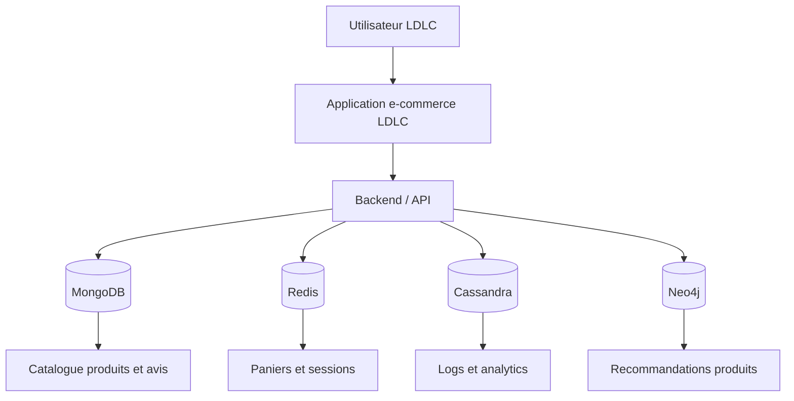

# Architecture globale — LDLC NoSQL

## Schéma d'architecture

## Description

L'architecture repose sur une approche de persistance polyglotte : chaque base de données NoSQL répond à un besoin spécifique.

- **MongoDB** : catalogue produits et avis clients.
- **Redis** : gestion des paniers et des sessions utilisateurs.
- **Cassandra** : stockage des événements, logs et statistiques.
- **Neo4j** : gestion des relations entre produits et recommandations.

Le backend/API représente une couche applicative conceptuelle, non développée dans ce projet.
