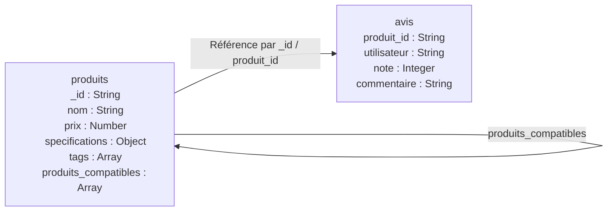
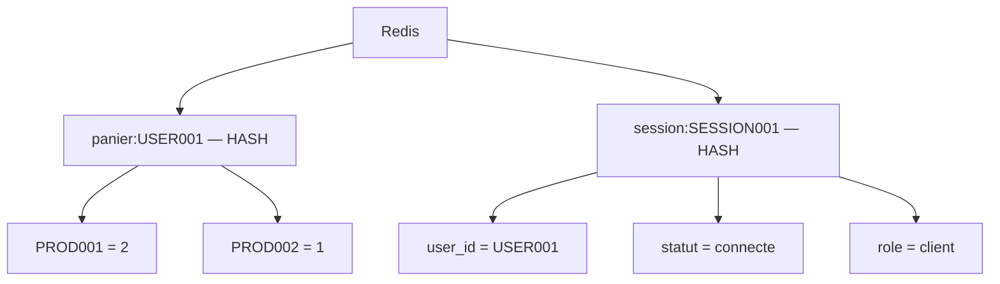
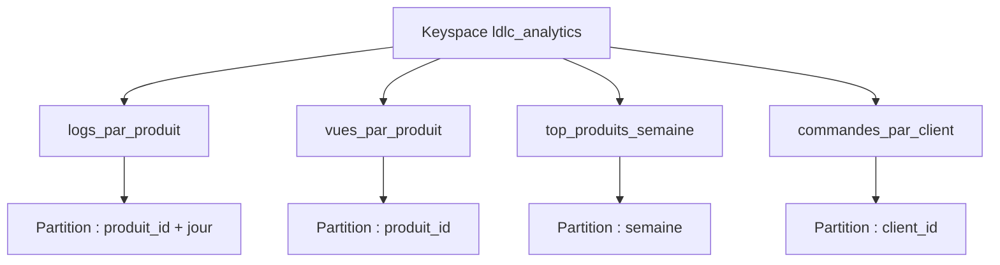
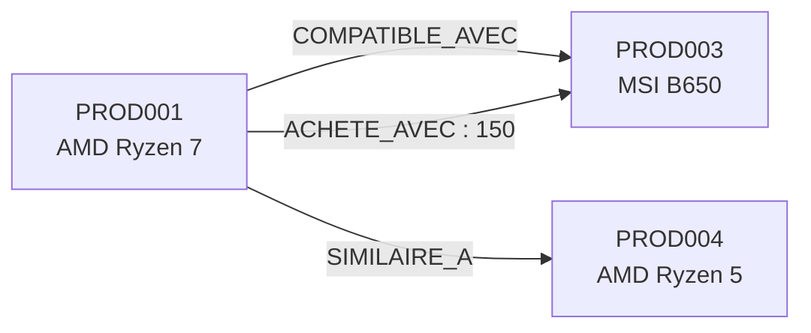

# Schémas de données — Projet LDLC NoSQL

Ce document présente les structures de données utilisées dans les quatre lots du projet : MongoDB, Redis, Cassandra et Neo4j.

## 1. MongoDB — Catalogue produits

MongoDB stocke les produits sous forme de documents JSON.

### Collection `produits`

| Champ | Type | Description |
|---|---|---|
| `_id` | String | Identifiant du produit |
| `nom` | String | Nom du produit |
| `categorie` | String | Catégorie |
| `marque` | String | Marque |
| `prix` | Number | Prix du produit |
| `stock` | Integer | Quantité en stock |
| `specifications` | Object | Caractéristiques techniques |
| `tags` | Array[String] | Mots-clés |
| `produits_compatibles` | Array[String] | Identifiants des produits compatibles |

Les champs du sous-document `specifications` varient selon la catégorie :

- Processeur : `socket` (String), `coeurs` (Integer), `threads` (Integer).
- Écran : `resolution` (String), `frequence_hz` (Integer), `connectique` (Array[String]).
- Carte mère : `chipset` (String), `format` (String), `wifi` (Boolean).

### Collection `avis`

| Champ | Type | Description |
|---|---|---|
| `_id` | ObjectId ou identifiant défini | Identifiant de l'avis |
| `produit_id` | String | Référence au produit |
| `utilisateur` | String | Identifiant utilisateur |
| `note` | Integer | Note attribuée |
| `commentaire` | String | Commentaire client |

### Relations MongoDB



**Modélisation :** Embedded pour les caractéristiques techniques et References pour les avis et les compatibilités.

## 2. Redis — Paniers et sessions

Redis utilise des clés associées à des structures de données.

### Panier utilisateur

```text
Clé : panier:USER001
Type Redis : HASH

PROD001 → "2"
PROD002 → "1"

TTL : 86400 secondes (24 heures)
```

| Élément | Type | Description |
|---|---|---|
| Clé | String | Identifiant du panier |
| Champ | String | Identifiant produit |
| Valeur | String numérique | Quantité |
| TTL | Integer | Durée de validité en secondes |

### Session utilisateur

```text
Clé : session:SESSION001
Type Redis : HASH

user_id → "USER001"
statut  → "connecte"
role    → "client"

TTL : 1800 secondes (30 minutes)
```

### Structure Redis



**Modélisation :** les Hash permettent de modifier directement les champs d'un panier ou d'une session. Les TTL gèrent leur expiration.

## 3. Cassandra — Logs et analytics

Keyspace : `ldlc_analytics`

Cassandra utilise des tables organisées selon les requêtes métier.

### Table `logs_par_produit`

| Champ | Type | Rôle |
|---|---|---|
| `produit_id` | text | Clé de partition |
| `jour` | date | Clé de partition |
| `event_id` | timeuuid | Clustering DESC |
| Autres champs événementiels | Selon le schéma CQL | Informations de l'événement |

### Table `vues_par_produit`

| Champ | Type | Rôle |
|---|---|---|
| `produit_id` | text | Clé de partition |
| `jour` | date | Clustering |
| `nb_vues` | counter | Nombre de consultations |

### Table `top_produits_semaine`

| Champ | Type | Rôle |
|---|---|---|
| `semaine` | text | Clé de partition |
| `rang` | int | Clustering |
| Autres champs | Selon le schéma CQL | Produit et statistiques du classement |

### Table `commandes_par_client`

| Champ | Type | Rôle |
|---|---|---|
| `client_id` | text | Clé de partition |
| `date_commande` | timestamp | Clustering DESC |
| `commande_id` | Selon le schéma CQL | Identifiant de commande |
| Autres champs | Selon le schéma CQL | Informations de commande |

### Structure Cassandra



**Modélisation :** chaque table est conçue pour une requête précise. Les partitions regroupent les données, tandis que les colonnes de clustering définissent leur ordre.

## 4. Neo4j — Recommandations produits

Neo4j représente les données sous forme de nœuds et de relations.

### Nœud `Produit`

| Propriété | Type | Description |
|---|---|---|
| `id` | String | Identifiant produit |
| `nom` | String | Nom du produit |
| `categorie` | String | Catégorie |
| `prix` | Float | Prix |

### Relations

| Relation | Propriété | Type |
|---|---|---|
| `COMPATIBLE_AVEC` | Aucune obligatoire | — |
| `SIMILAIRE_A` | Aucune obligatoire | — |
| `ACHETE_AVEC` | `nombre_achats` | Integer |

### Graphe des relations



**Modélisation :** les produits sont des nœuds et leurs liens représentent les compatibilités, les similarités et les achats conjoints.

## 5. Synthèse

| Lot | Technologie | Structure principale | Types utilisés |
|---|---|---|---|
| 1 | MongoDB | Documents / collections | String, Number, Boolean, Object, Array |
| 2 | Redis | Hash et clés | String, valeurs numériques, TTL |
| 3 | Cassandra | Tables wide-column | text, date, timeuuid, timestamp, int, counter |
| 4 | Neo4j | Nœuds et relations | String, Integer, Float, propriétés de relations |

Les quatre technologies utilisent des modèles différents, choisis selon les besoins du projet.

Les schémas détaillés et les scripts de création sont disponibles dans les dossiers de chaque lot.
